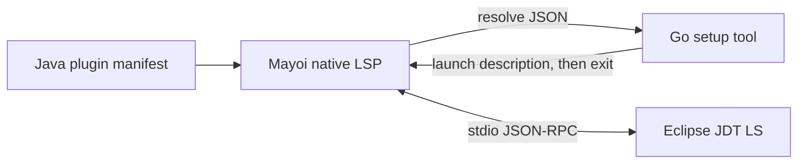

# Native Java plugin architecture

## Goals

Public users need Mayoi, a supported JDK, JDT LS, and a prebuilt Java setup tool.
Python, Node, and a Go toolchain are not runtime dependencies. Development builds
use Go to build the tool. Standard Java projects retain normal build and
annotation-processing behavior; compatibility workarounds are workspace options.

## Responsibilities

| Component | Owns | Lifetime |
| --- | --- | --- |
| Mayoi native LSP client (Go) | JSON-RPC, configuration requests, workspace folders, URI mappings, process shutdown/restart | Editor session |
| `mayoi-java` plugin (TypeScript) | Java settings, setup/doctor commands, resolver declaration | Plugin session |
| `mayoi-java` tool (Go, standard library) | JDK/distribution discovery, verified Lombok download, cache preparation, launch description | Setup or resolve command only |
| Eclipse JDT LS (Java) | Java project model, indexes, diagnostics and definitions | One per open workspace |

The native client runs the plugin's declared resolve command with the explicit
workspace root and plugin settings as JSON input. The installed tool returns a
launch description. Mayoi starts Java directly from this description. No proxy process
remains between the editor and JDT LS.



## Native resolver contract

`contributes.languageServers[].resolve` declares `{command, args}` for a short
setup process. It receives `{root, settings}` on stdin and returns JSON:

```ts
{
  command: string;
  args?: string[];
  env?: Record<string, string>;
  unsetEnv?: string[];
  initializationOptions?: unknown;
  configuration?: Record<string, unknown>;
  workspaceFolders?: {uri: string; name: string}[];
  pathMappings?: {clientURI: string; serverURI: string}[];
}
```

`${settings.helperPath}` expands from plugin settings without invoking a shell.
Static `command` contributions continue to work. Dynamic resolution does not
depend on the foreground editor. Paths are serialized as URI components and
mapped at the native protocol boundary, including URI-valued map keys.
Workspace and configuration responses come from the actual initialization
context rather than empty placeholders. Closing stdin and stopping the child
must complete pending requests even when the server exits unexpectedly.

## Configuration and compatibility

The tool reads the existing profile configuration and workspace overrides.
Normal defaults enable Java auto-build and annotation processing. Legacy
processor workarounds belong under a named workspace override. Lombok is an
independently installed agent and does not alter project dependency versions.

The previous Python launcher/proxy has been removed after native acceptance.
The Java source level is independent from the JDK used to run JDT LS. Existing
indexes persist across restarts when workspace identities and Java settings match;
the native version starts a fresh cache, separated by annotation-processing mode.

## Distribution

Release automation builds self-contained tools for macOS, Linux and Windows
and publishes SHA-256 checksums. Users install a prebuilt tool on PATH or set
the plugin's `helperPath`. Source builds are an alternative for contributors.
The plugin repository contains no machine-specific binaries or private project
paths. Native Mayoi changes are maintained separately for upstream review.

## Acceptance

- Native client tests cover configuration, folder identity, URI mappings,
  Unicode framing, server failure and bounded shutdown.
- Java tool tests cover configuration precedence, JVM arguments and downloads.
- Cross-compilation checks all distributed targets.
- Real JDT LS tests cover a symlinked Maven reactor and a Lombok getter.
- The existing multi-repository workspace must still navigate a same-file
  method, a cross-module service method and a generated getter, using workspace
  aliases without duplicate tabs. Measure warm latency and inspect server logs.

## Current verification

Native client and plugin tests, Go tool race tests and vet pass locally. Tools
cross-compile for all five release targets. On macOS arm64, real JDT LS imports
a grouped 53-module Maven workspace and resolves all three navigation cases;
the second native test round takes 432–495 ms per request. The running Mayoi Dev
also resolves all three through F12 and exposes the setup check command. Java is
a direct child of Mayoi, with no Python or helper process left running. The
large workspace uses a 4 GiB heap limit (about 1.54 GiB used at inspection).

Runtime acceptance on Linux, Windows, Gradle and SSH is pending. The native
Mayoi branch must land before plugin 0.3 can target normal upstream releases.
